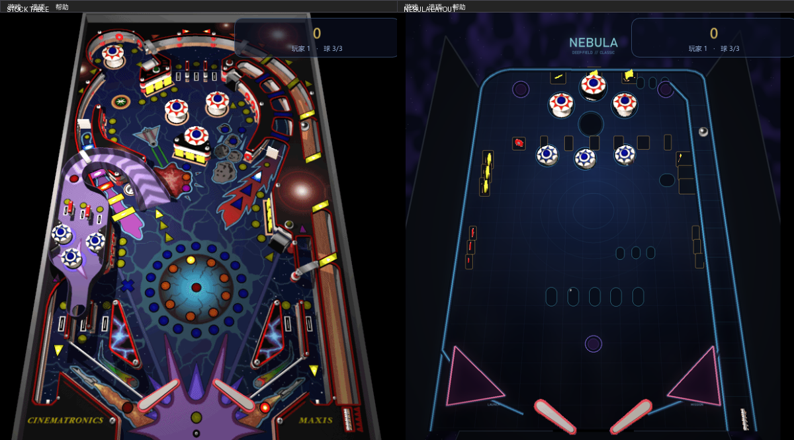

<!-- markdownlint-disable-file MD033 -->

# SpaceCadetPinball

## Summary

Reverse engineering of `3D Pinball for Windows - Space Cadet`, a game bundled with Windows.

## How to play

Place compiled executable into a folder containing original game resources (not included).\
Supports data files from Windows and Full Tilt versions of the game.

## Known source ports

| Platform           | Author          | URL                                                                                                        |
| ------------------ | --------------- | ---------------------------------------------------------------------------------------------------------- |
| PS Vita            | Axiom           | <https://github.com/suicvne/SpaceCadetPinball_Vita>                                                        |
| Emscripten         | alula           | <https://github.com/alula/SpaceCadetPinball> <br> Play online: <https://alula.github.io/SpaceCadetPinball> |
| Nintendo Switch    | averne          | <https://github.com/averne/SpaceCadetPinball-NX>                                                           |
| webOS TV           | mariotaku       | <https://github.com/webosbrew/SpaceCadetPinball>                                                           |
| Android (WIP)      | Iscle           | https://github.com/Iscle/SpaceCadetPinball                                                                 |
| Nintendo Wii       | MaikelChan      | https://github.com/MaikelChan/SpaceCadetPinball                                                            |
| Nintendo 3DS       | MaikelChan      | https://github.com/MaikelChan/SpaceCadetPinball/tree/3ds                                                   |
| Nintendo DS        | Headshotnoby    | https://github.com/headshot2017/3dpinball-nds                                                              |
| Nintendo Wii U     | IntriguingTiles | https://github.com/IntriguingTiles/SpaceCadetPinball-WiiU                                                  |
| PlayStation 2      | Headshotnoby    | https://github.com/headshot2017/3dpinball-ps2                                                              |
| Sega Dreamcast     | Headshotnoby    | https://github.com/headshot2017/3dpinball-dc                                                               |
| MorphOS            | BeWorld         | https://www.morphos-storage.net/?id=1688897                                                                |
| AmigaOS 4          | rjd324          | http://aminet.net/package/game/actio/spacecadetpinball-aos4                                                |
| Android (WIP)      | fexed           | https://github.com/fexed/Pinball-on-Android                                                                |

Platforms covered by this project: desktop Windows, Linux and macOS.

<br>
<br>
<br>
<br>
<br>
<br>

## Source

* `pinball.exe` from `Windows XP` (SHA-1 `2A5B525E0F631BB6107639E2A69DF15986FB0D05`) and its public PDB
* `CADET.EXE` 32bit version from `Full Tilt! Pinball` (SHA-1 `3F7B5699074B83FD713657CD94671F2156DBEDC4`)

## Tools used

`Ghidra`, `Ida`, `Visual Studio`

## What was done

* All structures were populated, globals and locals named.
* All subs were decompiled, C pseudo code was converted to compilable C++. Loose (namespace?) subs were assigned to classes.

## Custom table skins

The playfield art is baked into the `.DAT`, and the collision geometry was authored against it, so
the shipped table is never modified on disk. Instead a skin replaces the pixels of the loaded
playfield bitmap at runtime; the depth map, the sprites and every collision edge stay untouched.
Selecting `Original` copies the backup back, so switching is lossless and repeatable.

* Menu: `Options > Graphics > Table Theme`
* Keyboard: `F7` cycles through `Original` and every listed skin
* Command line: `-theme=<name>` (e.g. `-theme=neon-grid`) for testing

Skins live in `bin/themes/`:

```
bin/themes/
  themes.txt        one line per skin:  Display name|file.bmp|layout
  neon-grid.bmp
  violet-noir.bmp
  amber-dusk.bmp
  nebula.bmp        a whole second table, see below
```

Any BMP works. It is scaled to the playfield size on load (583x751 at the highest table
resolution), so a 1x skin can be dropped in without resizing by hand. Files listed in `themes.txt`
appear in the menu in that order; if the manifest is missing the three bundled skins are offered.

`tools/make_themes.py` regenerates the bundled skins. It draws the base wash, light pools, grid,
centre rings, launch lane and flipper funnel from scratch, then embosses the result with a
directional gradient of the original artwork so the surface still reads as a real playfield with
ramps and cut-outs:

```
python tools/make_themes.py            # writes bin/themes/*.bmp and themes-preview.png
```



## A second table: NEBULA

A skin only repaints the playfield. `Nebula`, the last line of `themes.txt`, also declares a
*layout* (the optional third field), and that turns the skin into a different table:

* the outer bowl, the shooter lane and the slingshots are replaced with new walls, installed as
  fresh collision edges and registered in the broad-phase grid;
* the bumper cluster, the target banks, the rollovers, the scoops, the one-way gates and the
  rebound posts are moved to new world coordinates, sprites included;
* everything left on the playfield that the layout does not use is taken off the table — its
  collision edges lose the ball's collision group and its sprite is flagged hidden, so the
  original hardware neither shows nor deflects anything;
* the flippers, the plunger, the drain and the rules are untouched, so the same game plays out on a
  completely different playfield.

Selecting `Original` restores the geometry from a snapshot taken the first time a layout was
applied, which makes the switch lossless and repeatable. `F8` cycles the layout on its own, without
changing the art, and `-debug` draws the collision overlay if you want to see where the walls
actually ended up.

`tools/nebula_layout.py` is the single source of truth for the second table: it defines the layout
in the engine's world coordinates, renders the matching artwork through the same perspective
projection the engine uses, and emits `SpaceCadetPinball/tablelayout_nebula.inc`, which the C++ side
consumes at runtime:

```
python tools/nebula_layout.py              # writes bin/themes/nebula.bmp and the .inc
python tools/nebula_layout.py --preview    # also writes nebula-preview.png
```

Known gaps: the insert lamps (`lite*`, `literoll*`) belong to the stock layout and are hidden rather
than remounted, so NEBULA leans on the artwork and the HUD for feedback; the bumper and target
sprites keep their original artwork; and the painted slingshots have no kicker behind them yet.

## Presentation and ball effects

The scoreboard column that is painted into the artwork is no longer shown. The window is sized
around the playfield alone, and the score moves into a floating HUD drawn over the top of it,
together with the ball counter, the player number and a `+score` marker that floats up and fades on
every gain.

* `Options > Graphics > Ball Motion Trail` — fading ghost trail behind the ball, on by default
* `Options > Graphics > Effect Ball` — gives the ball an elemental identity
* `Options > Graphics > UI Scale` — the atlas is rasterized at the scaled size instead of being
  stretched, so large text stays sharp (applies on restart)

Effect balls are palette-driven, so they drop straight into the existing 8-bit software renderer:
the sphere is tinted towards the element colour, the trail fades out through the same hue, and a
soft halo is composited around the ball. Eight kinds ship — `Classic`, `Fire`, `Ice`, `Electric`,
`Plasma`, `Rainbow`, `Ghost` and `Gold` — and the floating score markers pick up the same accent
colour, so scoring feedback matches the ball in play.

```
-ball=<0..7>        preselect an effect ball (0 = classic, matches the menu order)
```

Every capture in `docs/` was produced headless by `-screenshot=<path>` together with `-autoplay`,
and checked pixel by pixel with the harnesses in `tools/`.

## Compiling

Project uses `C++11` and depends on `SDL2` libs.

### On Windows

Download and unpack devel packages for `SDL2` and `SDL2_mixer`.\
Set paths to them in `CMakeLists.txt`, see suggested placement in `/Libs`.\
Compile with Visual Studio; tested with 2019.

### On Linux

Install devel packages for `SDL2` and `SDL2_mixer`.\
Compile with CMake; tested with GCC 10, Clang 11.\
To cross-compile for Windows, install a 64-bit version of mingw and its `SDL2` and `SDL2_mixer` distributions, then use the `mingwcc.cmake` toolchain.

[](https://repology.org/project/spacecadetpinball/versions) 

Some distributions provide a package in their repository. You can use those for easier dependency management and updates.

This project is available as Flatpak on [Flathub](https://flathub.org/apps/details/com.github.k4zmu2a.spacecadetpinball).

### On macOS

Install XCode (or at least Xcode Command Line Tools with `xcode-select --install`) and CMake.

**HomeBrew**

You can easily install the build artifact by using `brew`.

```sh
brew tap draftbrew/tap
brew install --no-quarantine space-cadet-pinball
```

Be aware that the flag `--no-quarantime` will disable macOS's Gatekeeper during installation.

**Manual compilation:**

* **Homebrew**: Install the `SDL2`, `SDL2_mixer` homebrew packages.
* **MacPorts**: Install the `libSDL2`, `libSDL2_mixer` macports packages.

Compile with CMake. Ensure that `CMAKE_OSX_ARCHITECTURES` variable is set for either `x86_64` Apple Intel or `arm64` for Apple Silicon.

Tested with: macOS Big Sur (Intel) with Xcode 13 & macOS Montery Beta (Apple Silicon) with Xcode 13.

**Automated compilation:**

Run the `build-mac-app.sh` script from the root of the repository. The app will be available in a DMG file named `SpaceCadetPinball-<version>-mac.dmg`.

Tested with: macOS Ventura (Apple Silicon) with Xcode Command Line Tools 14 & macOS Big Sur on GitHub Runner (Intel) with XCode 13.

## Plans

* ~~Decompile original game~~
* ~~Resizable window, scaled graphics~~
* ~~Loader for high-res sprites from CADET.DAT~~
* ~~Cross-platform port using SDL2, SDL2_mixer, ImGui~~
* Full Tilt Cadet features
* Localization support
* Maybe: Support for the other two tables - Dragon and Pirate
* Maybe: Game data editor

## On 64-bit bug that killed the game

I did not find it, decompiled game worked in x64 mode on the first try.\
It was either lost in decompilation or introduced in x64 port/not present in x86 build.\
Based on public description of the bug (no ball collision), I guess that the bug was in `TEdgeManager::TestGridBox`
